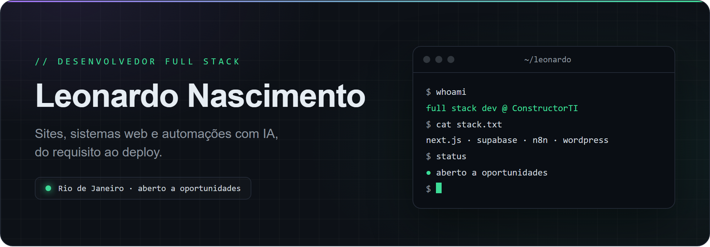
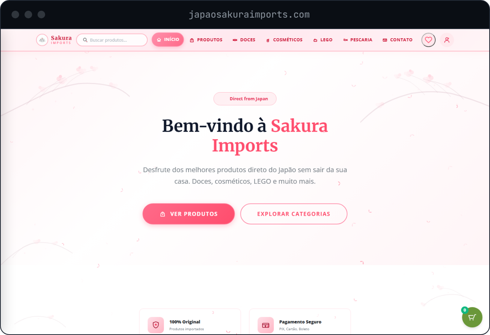
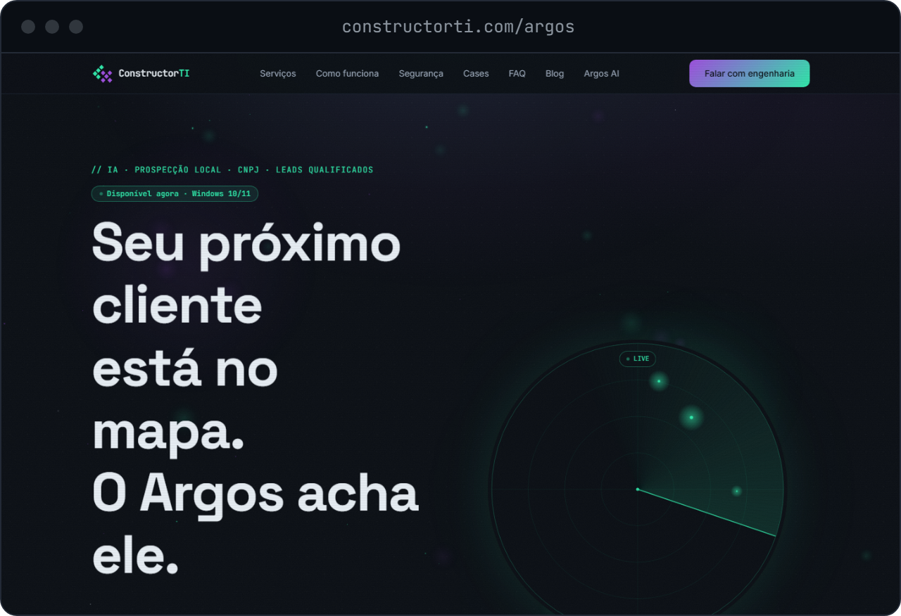
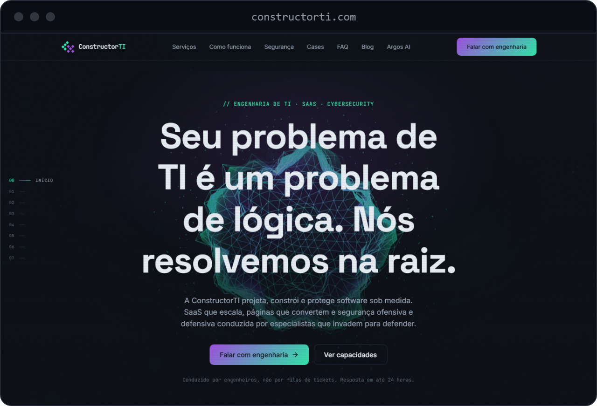
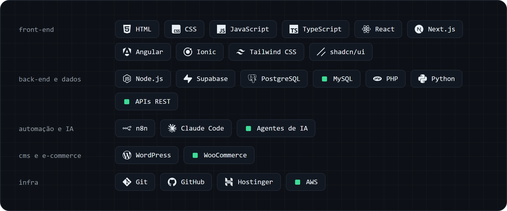
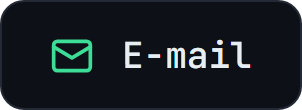
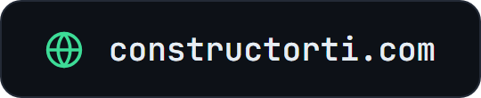
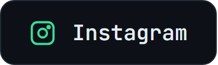

## Sobre mim

Sou desenvolvedor full stack, formado em Análise e Desenvolvimento de Sistemas pela UNISUAN. Na [ConstructorTI](https://constructorti.com), construo sites, lojas virtuais, sistemas web e automações com IA para pequenas e médias empresas, do levantamento de requisitos ao deploy.

- **Agora:** desenvolvendo projetos para clientes e produtos próprios na ConstructorTI
- **Estudando:** segurança ofensiva
- **Certificação:** AWS Certified Cloud Practitioner
- **Buscando:** uma vaga de desenvolvedor em um time de produto

## Projetos em destaque

<table>
  <tr>
    <td width="33%" valign="top">
      
      <h3><a href="https://japaosakuraimports.com">Japão Sakura Imports</a></h3>
      E-commerce completo, do catálogo ao checkout, em operação.
        
      <code>WordPress</code> <code>WooCommerce</code>
    </td>
    <td width="33%" valign="top">
      
      <h3><a href="https://constructorti.com/argos">Argos</a></h3>
      Software desktop que gera listas de leads B2B por nicho e cidade, cruzando OpenStreetMap com dados públicos de CNPJ.
        
      <code>Desktop</code> <code>Windows</code> <code>OpenStreetMap</code>
    </td>
    <td width="33%" valign="top">
      
      <h3><a href="https://constructorti.com">ConstructorTI</a></h3>
      Site da minha empresa de engenharia de software, SaaS e segurança.
        
      <code>Site institucional</code>
    </td>
  </tr>
</table>

### Também construí

- **Agentes de IA para prospecção:** equipe de 7 agentes especializados no n8n, integrada à nova Google Places API.
- **Painel de gestão para food truck:** sistema offline-first com Next.js 14, Tailwind CSS, shadcn/ui, Dexie.js e Recharts.

## Stack

## Contato

